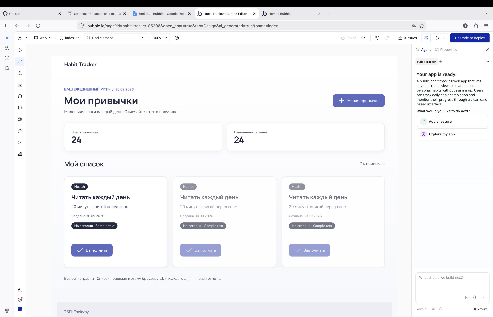
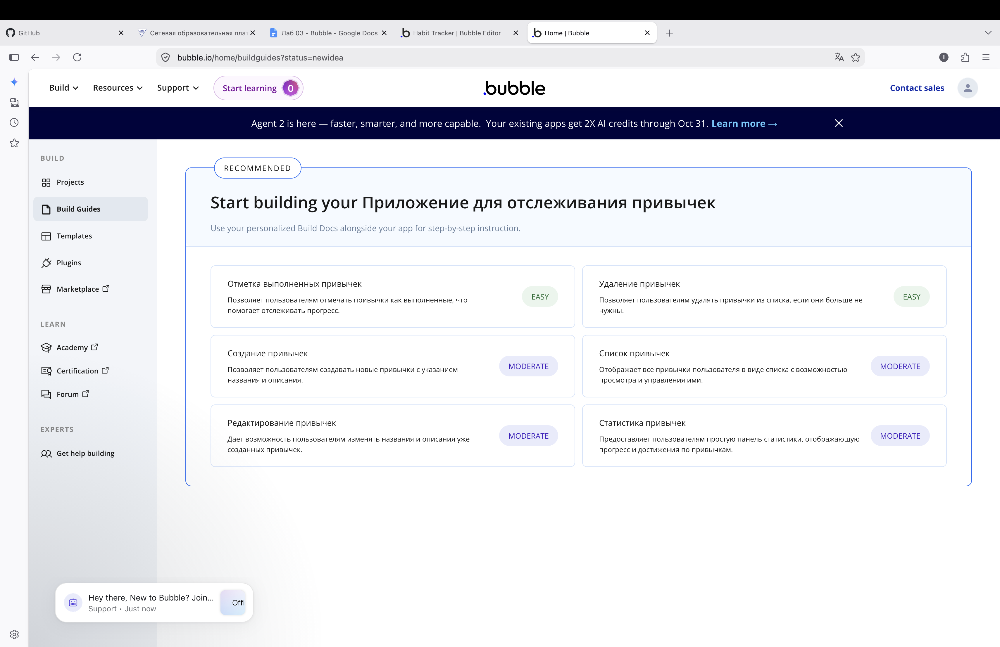
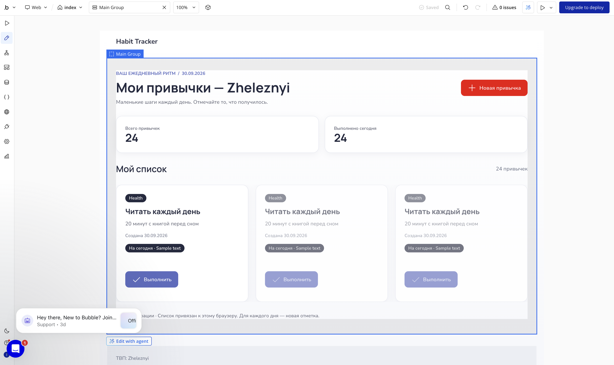
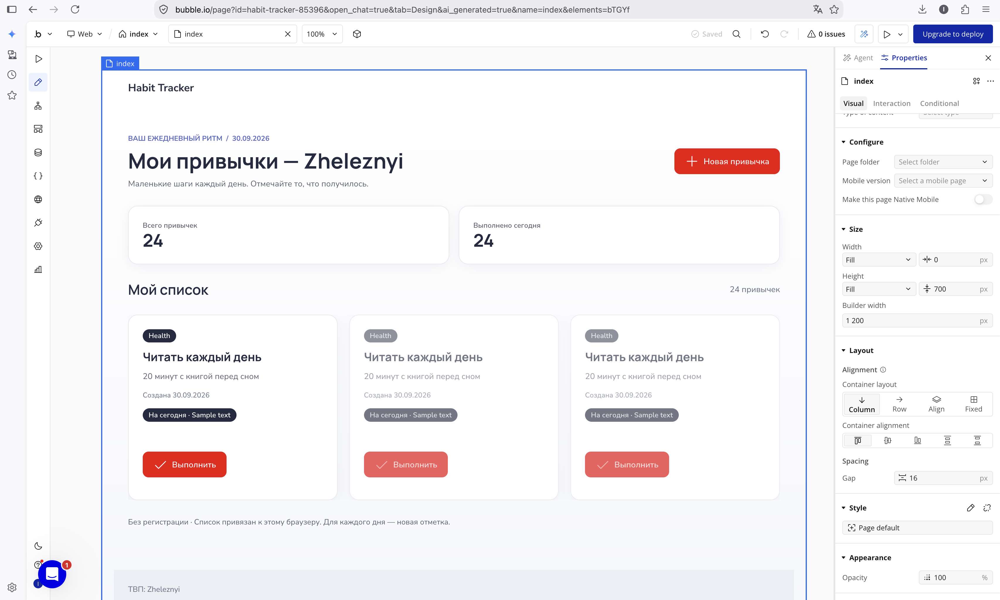
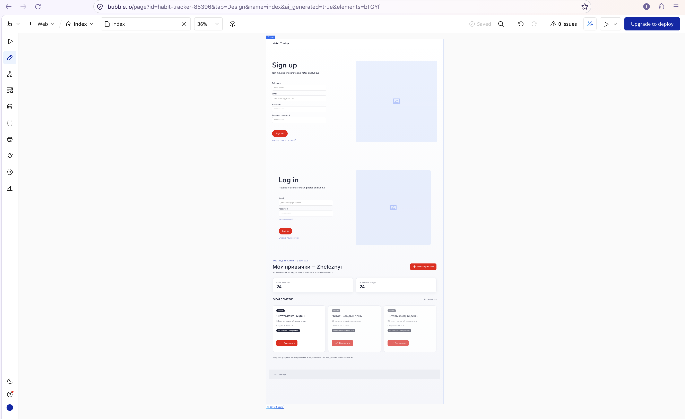
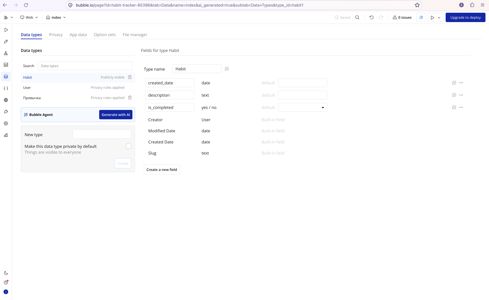
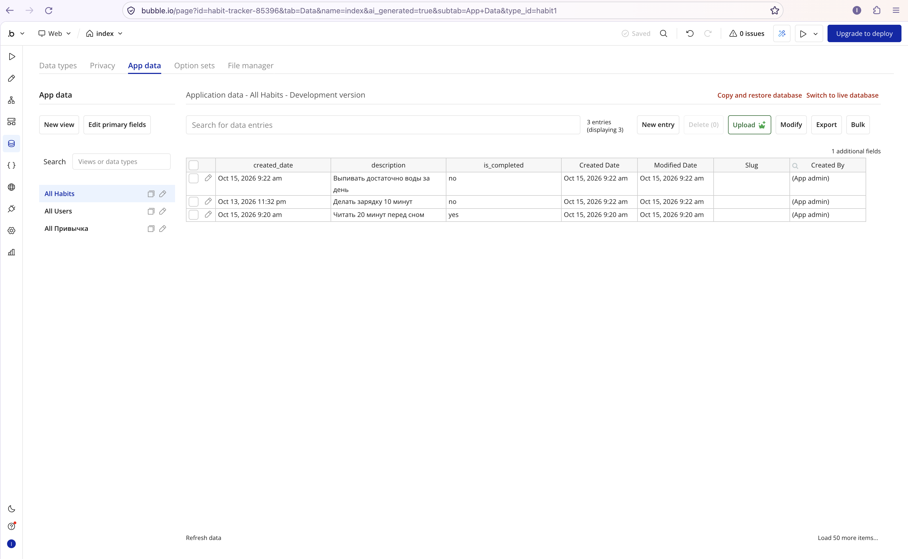
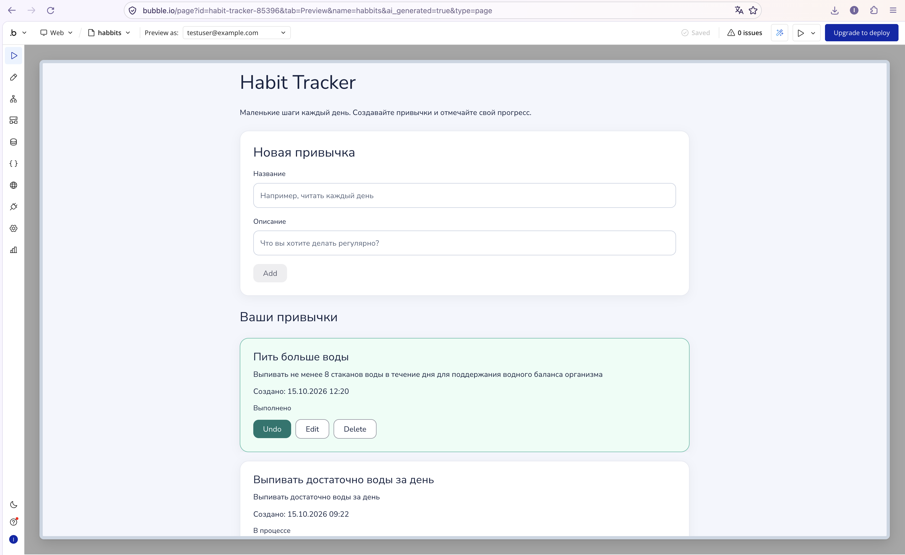
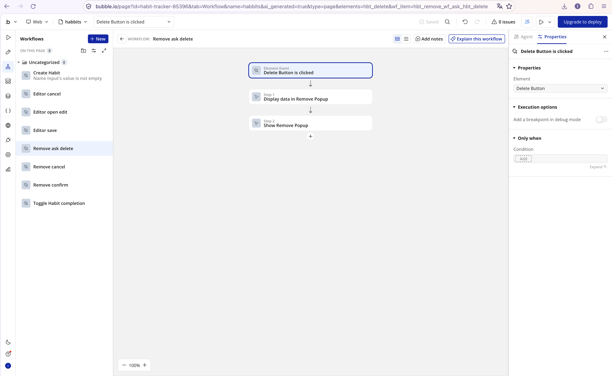
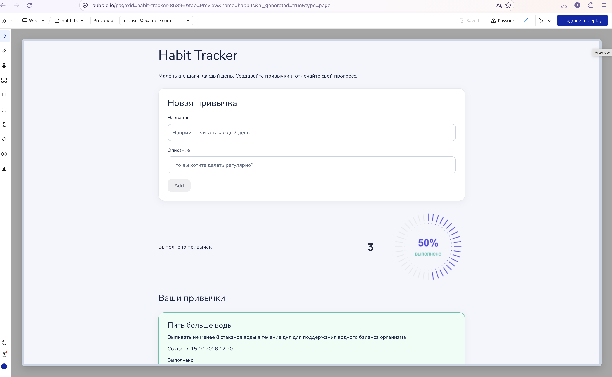

Лабораторная работа № 3. Разработка приложения в Bubble
1. Цель работы
Изучить возможности no-code платформы Bubble: генерацию приложения с помощью AI, работу с Build Guides, настройку интерфейса, создание типов данных, использование workflows для CRUD-операций и подключение сторонних плагинов.
2. Разработка приложения с помощью AI
Для лабораторной работы выбрано приложение Habit Tracker — трекер повседневных привычек. В начальном интерфейсе предусмотрены заголовок, карточки привычек, блок статистики и кнопки действий.
Для генерации начального каркаса приложения использовался встроенный AI Agent Bubble.
Исходный промпт
Создай приложение на тему «Трекер привычек».

Пусть этот сайт будет публичным, без обязательной регистрации.

Страницу обязательно создай по структуре header + body + footer.

В header размести название приложения «Habit Tracker».

В основной части создай интерфейс для ведения списка привычек. Добавь возможность создавать привычки, просматривать список существующих привычек, редактировать их название и описание, отмечать выполнение и удалять записи.

Для каждой привычки предусмотрите название, описание, дату создания и статус выполнения.

Добавь несколько интерактивных элементов, реализующих CRUD (Create, Read, Update, Delete).

Используй аккуратный современный дизайн, понятную навигацию, карточки привычек и кнопки действий.

В footer обязательно добавь строку: «ТВП: Zheleznyi».
Скриншот 1 — исходный промпт и сгенерированный интерфейс Habit Tracker.
После генерации каркас приложения был доработан вручную: изменён заголовок страницы, добавлены и настроены элементы интерфейса, создана отдельная страница habits для работы с данными.
3. Изучение Build Guides
Для получения рекомендаций по реализации приложения использовался раздел Build Guides. В качестве идеи была указана система отслеживания привычек с возможностью создания, просмотра, редактирования, удаления записей и отметки выполнения.

Скриншот 2 — рекомендации Build Guides по реализации функций трекера привычек.
В рекомендациях рассматривались создание привычек, отображение списка, редактирование и удаление записей, отметка выполнения и статистика. Эти рекомендации помогли определить основные действия приложения и порядок дальнейшей работы.
4. Ручная настройка интерфейса
После AI-генерации были выполнены изменения через визуальный редактор Bubble.
4.1. Изменение заголовка
Заголовок страницы изменён с добавлением фамилии, чтобы выполнить требование лабораторной работы.
4.2. Глобальная переменная
В редакторе изучались глобальные переменные и возможность использовать переменную типа Color для общего цвета элементов приложения.

Скриншот 3 — настройка глобальной переменной цвета.
4.3. Пользовательский стиль
Создан пользовательский стиль для кнопки. Использование стилей позволяет повторно применять одинаковое оформление к элементам и упрощает согласованное изменение интерфейса.

Скриншот 4 — создание пользовательского стиля элемента.
4.4. Готовый UI-компонент
Из библиотеки компонентов Bubble добавлен готовый UI-компонент. Его оформление подбиралось с учётом интерфейса трекера привычек.

Скриншот 5 — добавленный компонент из библиотеки Bubble.
5. Создание структуры данных
Для хранения привычек создан тип данных Привычка со следующими полями:
Поле	Тип	Назначение
Name	text	Название привычки
description	text	Описание привычки
created_date	date	Дата создания
is_completed	yes/no	Статус выполнения

Name — стандартное поле названия записи в Bubble. Остальные поля добавлены для хранения характеристик привычки.

Скриншот 6 — тип данных Привычка и его поля.
В разделе App data добавлены тестовые записи. Они позволяют проверить получение и отображение информации на странице.

Скриншот 7 — примеры записей типа Привычка.
Тип данных создавался вручную в разделе Data types. Отдельный AI-промпт для создания этой сущности не использовался.
6. Страница работы с привычками и CRUD
Для работы с записями создана отдельная страница habits. В Bubble операции CRUD реализуются через источники данных, элементы интерфейса и workflows.
6.1. Read — чтение и отображение записей
Для вывода списка используется Repeating Group. В качестве типа содержимого выбран тип данных Привычка, а источником данных служит поиск записей этого типа. В ячейках используются динамические значения названия и описания текущей записи.

Скриншот 8 — настройка отображения списка привычек.
В Preview отображались записи, в том числе «Выпивать стакан воды сразу после пробуждения», «Ежедневный прием комплекса витаминов», «Бег 20 минут в парке» и «Медитация 5 минут утром».
6.2. Create — создание записи
На страницу добавлены два поля ввода — для названия и описания привычки — и кнопка Добавить привычку. Для полноценной операции Create кнопка должна запускать workflow с действием создания новой записи типа Привычка и передавать в неё значения полей формы.

Скриншот 9 — workflow создания привычки.
6.3. Update — изменение записи
Операция Update предполагает выбор существующей привычки, редактирование её полей и сохранение изменений в той же записи. Для реализации используется workflow с действием изменения данных существующего объекта. Перед защитой следует проверить, что изменение действительно сохраняется и отображается в списке.
6.4. Delete — удаление записи
Для операции Delete используется отдельный workflow, который удаляет выбранную запись типа Привычка. После выполнения действия запись должна исчезать из списка.

Скриншот 10 — workflow удаления привычки.
7. Дополнительное достижение: Plugins
В качестве дополнительного достижения выбран вариант Plugins. Установлен плагин Radial Progress Chart, предназначенный для отображения числового прогресса в виде круговой диаграммы.

Скриншот 11 — установленный плагин Radial Progress Chart.
8. Использованные AI-инструменты
В ходе работы использовались следующие возможности Bubble:
- AI Agent — генерация начального каркаса приложения по исходному промпту из раздела 2.
- Build Guides — рекомендации по реализации основных функций приложения.
Остальные изменения выполнялись через визуальный редактор Bubble: настройка элементов, создание типа данных, добавление Repeating Group, работа с workflows и установка плагина.
В качестве идеи для Build Guides использовалось описание приложения для отслеживания привычек: создание записей, просмотр списка, отметка выполнения, редактирование и удаление привычек, отображение статистики. Если преподаватель требует дословные тексты всех запросов, их следует сверить с историей Bubble и вставить без пересказа.
9. Ссылка на dev-версию приложения
Ссылка: https://habit-tracker-85396.bubbleapps.io/version-test?debug_mode=true
10. Выводы
В ходе лабораторной работы был создан каркас приложения Habit Tracker на платформе Bubble. AI Agent ускорил начальную генерацию интерфейса, а Build Guides помогли определить функции, которые необходимо реализовать.
При ручной доработке были изучены редактирование элементов, глобальные переменные, пользовательские стили, готовые UI-компоненты и структура данных. Для хранения привычек создан тип Привычка с полями названия, описания, даты создания и статуса выполнения. Для отображения записей использован Repeating Group.
Также был установлен плагин Radial Progress Chart для визуализации прогресса. Работа показала, что AI-генерация создаёт основу приложения, но корректная структура данных, логика workflows и проверка CRUD-операций требуют отдельной настройки и тестирования.