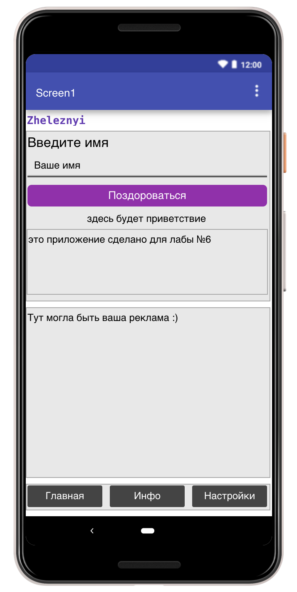
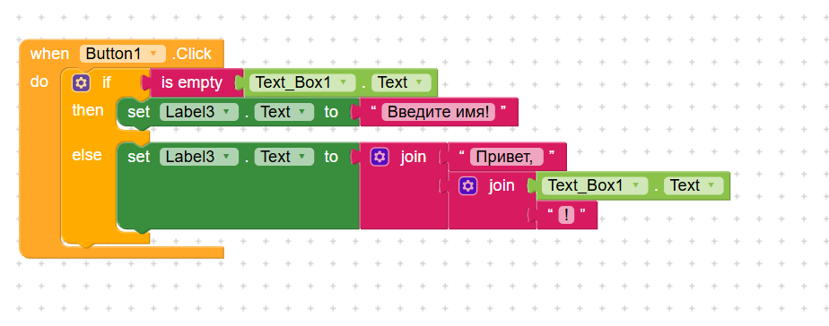
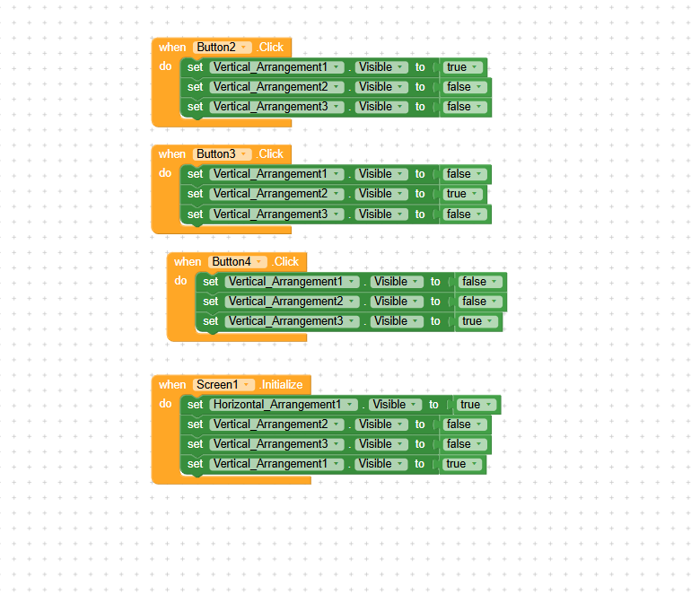
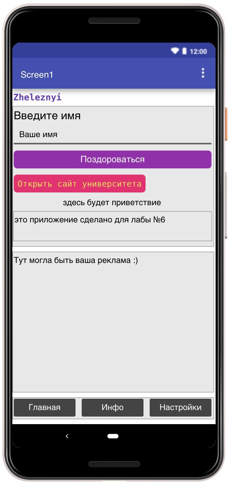
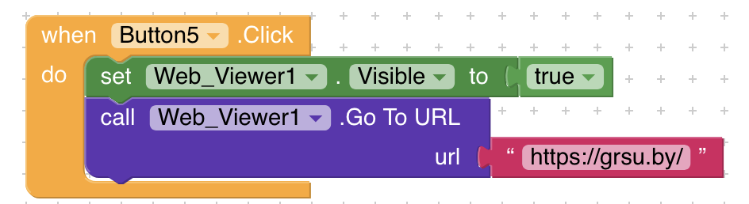

# Лабораторная работа №6 (Kodular)

## 1. Базовое задание: Приложение «Приветствие»

**Реализованный функционал:**

Создан первый экран приложения, содержащий обязательные элементы: заголовок «Введите имя», текстовое поле (TextBox) с подсказкой «Ваше имя», кнопку «Поздороваться» и лейбл для вывода результата. В верхней части экрана размещен лейбл с фамилией на английском языке — **Zheleznyi**.

**Логика работы (Блоки):**

При нажатии на кнопку срабатывает условный оператор `if`. С помощью блока `is empty` проверяется, пустое ли текстовое поле:

- Если поле пустое, в нижний лейбл выводится текст «Введите имя!».
- Если поле заполнено, с помощью блока `join` формируется приветствие: «Привет, » + введенное имя + «!».

**Скриншоты базовой части:**

---

## 2. Ачивка №3: Bottom Navigation (Нижнее меню)

**Описание:**

В приложении реализована навигация по трем разделам («Главная», «Инфо», «Настройки») с помощью нижнего меню. Переключение между разделами происходит за счет изменения видимости макетов (Layout).

**Использованные компоненты:**

1. **VerticalArrangement (Layout1, Layout2, Layout3):** три вертикальных макета, которые занимают весь экран. В первом находится базовое приложение (приветствие), во втором — текст с информацией, в третьем — текст настроек.
2. **HorizontalArrangement:** нижняя панель, которая служит контейнером для кнопок меню.
3. **Button (Button2, Button3, Button4):** три кнопки нижнего меню для переключения вкладок.

**Использованные блоки (Логика):**

1. **`Screen1.Initialize`:** при запуске приложения скрываются вторая и третья вкладки (`Visible = false`), а нижнее меню и первая вкладка становятся видимыми (`Visible = true`).
2. **`Button.Click`:** для каждой кнопки меню написан свой обработчик нажатия.
3. **`set ... Visible to`:** при нажатии на кнопку «Главная» макет `Layout1` становится видимым (`true`), а `Layout2` и `Layout3` скрываются (`false`). Аналогично настроены кнопки «Инфо» и «Настройки» для показа соответствующих макетов.

**Скриншот логики Ачивки №3:**

**Решение проблемы с «прыгающим» меню:**

При тестировании выяснилось, что при переключении на вкладки «Инфо» и «Настройки» нижнее меню поднималось вверх, так как невидимые макеты не занимали места на экране. Для исправления этой проблемы в Designer был добавлен компонент **Space** с параметрами `Width = Fill parent` и `Height = Fill parent`. Он был размещен в дереве компонентов между макетами вкладок и нижним меню (`HorizontalArrangement`).

Теперь свободное пространство занимает компонент Space, поэтому нижнее меню остается в нижней части экрана независимо от выбранной вкладки.

---

## 3. Ачивка №9: Web Viewer

**Описание:**

В приложение добавлена дополнительная функция, позволяющая открывать сайт университета непосредственно внутри приложения, без перехода во внешний браузер. Для этого была создана кнопка «Открыть сайт университета» и добавлен компонент Web Viewer.

**Использованные компоненты:**

1. **Button (Button_WebViewer):** кнопка, при нажатии на которую открывается сайт.
2. **Web Viewer (Web_Viewer1):** компонент для отображения веб-страниц непосредственно внутри приложения.

**Использованные блоки (Логика):**

При нажатии на кнопку `Button_WebViewer.Click` выполняются следующие действия:

1. **`set Web_Viewer1.Visible to true`:** делает компонент Web Viewer видимым.
2. **`call Web_Viewer1.GoToUrl`:** загружает указанный сайт внутри приложения. В качестве адреса используется `https://bsu.by/`.

Таким образом, пользователь может открыть сайт университета, не покидая приложение.

**Скриншоты реализации Ачивки №9:**

---

## 4. Использованные AI-промпты

1. «Как в Kodular сделать так, чтобы при нажатии на кнопку проверялось, пустое ли текстовое поле, и выводилось сообщение?»
2. «Почему у меня блок с if не влазит в блок с when?»
3. «Как реализовать нижнее меню в Kodular?»
4. «Как добавить Web Viewer и настроить открытие сайта по нажатию кнопки?»
5. «Как сделать так, чтобы Web Viewer открывал сайт внутри приложения, а не во внешнем браузере?»

---

## 5. Освоенные компоненты и блоки

**Компоненты:** Label, TextBox, Button, VerticalArrangement, HorizontalArrangement, Space, Web Viewer.

**Блоки:** `when ... do`, `if / then / else`, `is empty`, `join`, `set ... to`, `Visible` (true/false), `Initialize`, `GoToUrl`.

---

## 6. Выводы

В ходе выполнения лабораторной работы я познакомилась с платформой визуального программирования Kodular. Настроила интерфейс приложения, использовала макеты для структурирования элементов и реализовала логику с помощью визуальных блоков.

В базовой части было создано приложение «Приветствие». Дополнительно реализована ачивка №3 (Bottom Navigation), позволяющая переключаться между разделами в рамках одного экрана, и ачивка №9 (Web Viewer), с помощью которой можно открывать веб-страницы непосредственно внутри приложения.

В результате работы были освоены основные компоненты Kodular, принципы обработки событий, условные конструкции и управление видимостью элементов интерфейса.